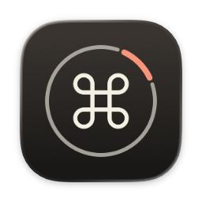
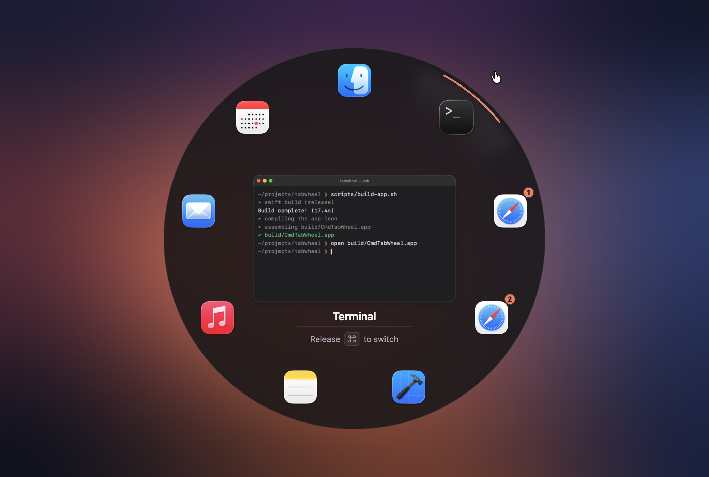

<p align="center">
  
</p>

<h1 align="center">⌘Tab Wheel</h1>

<p align="center">
  <b>A radial app switcher for macOS.</b><br>
  Hold ⌘, press Tab, flick toward an app, let go.
</p>

<p align="center">
  
</p>

The system switcher is a row. To reach the fifth app you press Tab five times, and the order reshuffles every time you switch. ⌘Tab Wheel puts every running app on a ring instead: each one is a direction, not a number of presses. Apps keep their slots, so after a while your hand knows where Mail is without looking.

## Features

- **Flick, don't count.** Only the direction of the pointer from the center of the wheel matters, so the cursor can be anywhere on screen. Or click a sector to switch right away.
- **Slots that stay put.** Apps sit in the order they were launched and keep their place from one ⌘Tab to the next.
- **Quick ⌘Tab still works.** Tap ⌘Tab and let go without touching anything to jump back to the previous app, just like the system switcher.
- **Keyboard too.** Tab and ⇧Tab walk around the wheel, Esc closes it.
- **Windows, not just apps.** An app with several windows gets a sector per window, or one sector with its windows fanned out past the rim. You choose under *Windows* in the menu bar.
- **Live previews.** The middle of the wheel shows the exact window you're about to switch to.
- **Native and light.** AppKit and SwiftUI, lives in the menu bar, no Dock icon. Follows light and dark mode.
- **One switch to turn it off.** Flip it off in the menu bar and the system ⌘Tab is back.

## Install

There are no prebuilt releases yet, so build it from source. You need macOS 14 or later and Xcode 16 or later.

```bash
git clone https://github.com/faustienf/tabwheel.git
cd tabwheel
scripts/build-app.sh
open build/CmdTabWheel.app
```

On first launch the app offers to move itself to Applications, then opens a setup window that walks you through the permissions.

### Permissions

| Permission | | What it's for |
|---|---|---|
| **Accessibility** | Required | Catching ⌘Tab and bringing the window you pick to the front |
| **Screen Recording** | Optional | Window previews in the middle of the wheel. Without it you see app icons |
| **Open at login** | Optional | Starting in the menu bar when you log in |

The setup window shows what's granted as you grant it and opens the right page of System Settings for each permission. It's always there under the menu bar icon → *Setup…*

## Using it

| | |
|---|---|
| **⌘Tab** | Open the wheel, keep holding ⌘ |
| **Move the pointer** | Select the app in that direction |
| **Tab / ⇧Tab** | Next / previous app |
| **Release ⌘** | Switch to the selected app |
| **Click** | Switch to the app under the pointer |
| **Esc** | Close without switching |

In the menu bar:

- **⌘Tab Wheel** — turns the wheel on or off.
- **Appearance** — follow the system, or always light or dark.
- **Windows** — one sector per window, or windows fanned out past the rim.
- **Setup…** — permissions and open at login.

## How it works

- **Catching ⌘Tab.** A `CGEventTap` listens for ⌘Tab while the system's own ⌘Tab hotkey is switched off through `CGSSetSymbolicHotKeyEnabled`, the same trick [AltTab](https://github.com/lwouis/alt-tab-macos) uses. Quitting the app turns the system one back on.
- **The wheel.** A full-screen, non-activating panel in the style of Spotlight: it takes the mouse and keyboard without taking focus away from the app you came from.
- **Previews.** When the wheel opens, ScreenCaptureKit captures every window on it in parallel. The pictures are cached, so the next ⌘Tab shows them instantly while fresh ones load.
- **Switching to one particular window.** Private SkyLight calls plus the Accessibility API raise exactly the window you picked, not just its app.

The private APIs and the event tap mean this app can't go on the Mac App Store.

## Development

Open `Package.swift` in Xcode and press ⌘R. The shared scheme builds the app, wraps it into `build/CmdTabWheel.app` and runs it under the debugger.

From the terminal, this builds, restarts the app and streams its logs:

```bash
scripts/run.sh
```

- **Lost your ⌘Tab?** If the app dies without cleaning up (a crash, `kill -9`, Xcode's Stop button), the system ⌘Tab can stay off. The Xcode scheme fixes this for you after Stop. Otherwise run:

  ```bash
  build/CmdTabWheel.app/Contents/MacOS/CmdTabWheel --restore-native-switcher
  ```

- **The icon.** `Support/AppIcon.icon` is an Icon Composer document (Xcode → Open Developer Tool → Icon Composer). `scripts/draw-icon-layers.swift` draws its layers, and `scripts/bundle-app.sh` compiles it with `actool` on the next build.
- **Debug builds** never offer to move themselves to Applications.

## Status

Early, so expect rough edges. There are no releases yet, and builds aren't notarized.

## License

[MIT](LICENSE)
